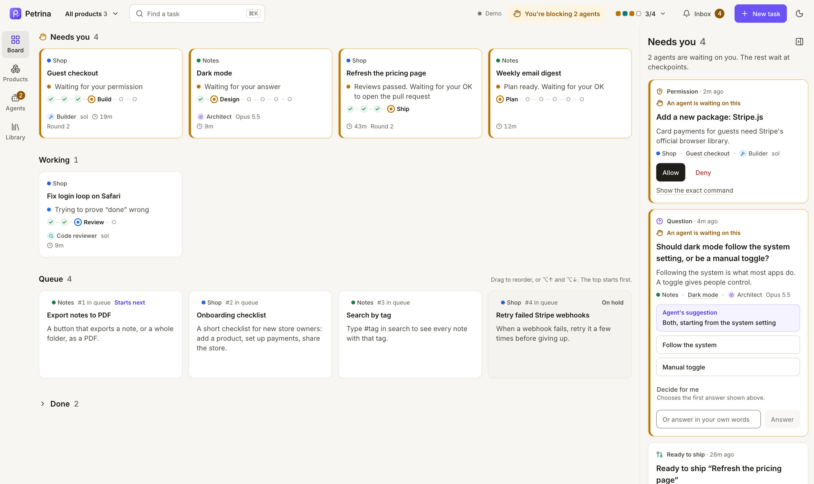
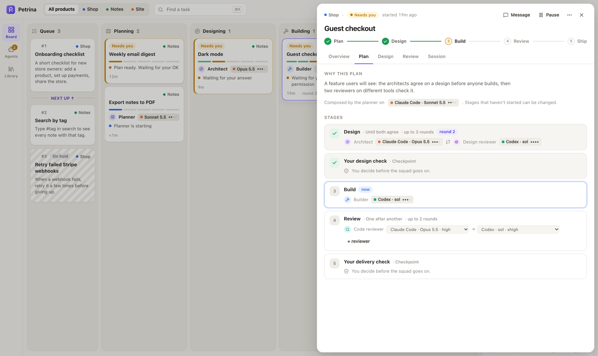
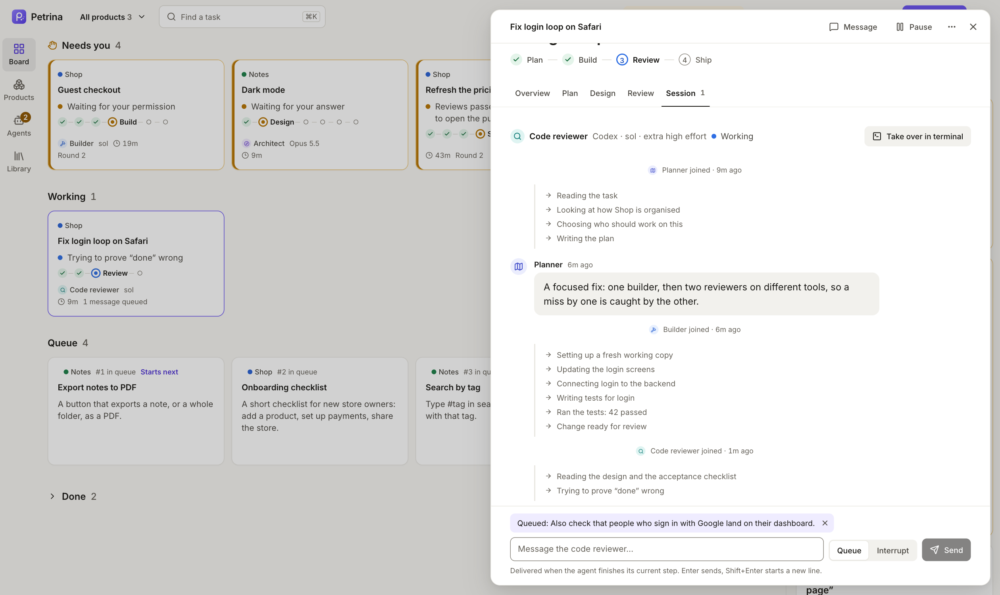

<p align="center">
  
</p>

<h1 align="center">Petrina</h1>

<p align="center">
  A desktop app for builders who run a squad of AI coding agents.<br />
  You set priorities and make the calls. The squad plans, designs, builds and reviews, then hands you a pull request.
</p>

<p align="center">
  
</p>

## What it does

- **A board for your products.** Every task is a card, grouped by what it needs: you first, then work in progress, then the queue. Each card shows its own progress through its plan (plan, design, your check, build, review, ship) and says, in plain language, who is working on it and what they are doing.
- **A queue you control.** Drag tasks to set priority. The top of the queue starts first, as soon as a slot is free. Hold a task to keep it from starting.
- **Many products.** A searchable product switcher (⌘P) and a Products page that shows every product's pipeline and what waits on you, so twenty products stay as calm as two.
- **A pool of agents.** Choose how many agents may run at once, with caps per tool so one subscription is not exhausted. See who is in each slot.
- **Roles, not tools.** Planner, Researcher, Architect, Design reviewer, UX designer, Builder, Tester and Code reviewer are first-class. Any role can run on any tool, model and effort: Claude Code with Opus 5.5 as the architect, Codex at xhigh effort as its reviewer.
- **A plan per task.** The planner composes the stages for each task: a bug fix might be one builder and two reviewers, something new gets research, a design both architects agree on, screens, tests and three reviewers. You can change the plan before it runs.
- **Architects who have to agree.** Two architects on different tools iterate until no blocking objection is left. The disagreement log shows every objection and how it was answered.
- **Reviews in a chain.** Reviewers run one after another, each seeing earlier verdicts but never the builder's transcript. Findings are pass or fail, merged and attributed.
- **A "Needs you" inbox.** Questions, permission requests, plan and design checks, and delivery approvals, each with one-click answers. It tells you when you are the one blocking agents.
- **Join any agent.** Open the live session of the agent working on a task, read along, and message it. Messages queue until the agent finishes its current step, or interrupt it right away. Take over in your own terminal when you want to drive.
- **No code in the app.** You see plans, briefs, checklists and verdicts. The code lives in the pull request. Petrina never merges.

<p align="center">
  
  
</p>

## How it runs agents

Petrina talks to agents through the [Agent Client Protocol](https://agentclientprotocol.com). Claude Code and Codex both have maintained ACP adapters, and any other agent that speaks ACP works the same way, so adding a tool is usually configuration. Everything runs on your machine with the tools you are already logged into: no API keys, no Petrina server, no telemetry. Details are in [docs/design.md](docs/design.md); the UX it is built from is in [docs/ux.md](docs/ux.md).

## Status

Early, and working: the engine runs real Claude Code and Codex agents over ACP in their own git worktrees, with the planner, design convergence, review chain, permissions, questions and delivery (pull request, release, or a commit to main) wired end to end. The desktop app starts its engine by itself. Opened in a browser any other way than `bun run open`, the screens run on a simulated squad (`?demo` or `?demo=portfolio`).

## Develop

You need [Bun](https://bun.sh) 1.4, and for the desktop shell, Rust and the [Tauri prerequisites](https://tauri.app/start/prerequisites/) for your OS.

```bash
bun install
bun run tauri dev    # the desktop app; it starts its own engine (data in ~/.petrina)
bun run open         # Petrina in your browser, connected to the running engine
bun run test         # core and engine tests (fake agents and a fake GitHub, no tokens spent)
bun run typecheck
```

The desktop app starts the engine when it opens and stops it when you quit. If an engine is already running for the same Petrina folder, the app uses that one and leaves it running when you quit; the Live label says which it is. You can still start the engine by hand with `bun run engine` (on 127.0.0.1:4317) and use the screens in a browser with `bun run dev` and `bun run open`. An engine started by hand keeps its key across restarts, so open browser windows reconnect; `bun run engine --new-key` makes a new one. Only one engine runs per Petrina folder: a second one says it is already running. The engine's output goes to `~/.petrina/engine.log`, started fresh each time.

`bun run petrina state` prints the engine's state, and `bun run petrina do '<action json>'` runs an action, for scripts. They work whoever started the engine.

The engine's key never goes in a web address in the app: the window asks the app's shell for it and keeps it in memory. `bun run open` puts it after the `#` in the address (browsers never send that part anywhere) and the page removes it at once.

### Quitting, crashes and restarts

- **Running agents.** Quitting the app stops the engine it started. Its agents stop the way they do when you pause a task; their tasks wait for a free slot and continue the next time Petrina opens. Each agent then picks up its own conversation, keeping what it had read and planned, and is told that Petrina restarted and that its last action may not have finished; the timeline says "Picked up where it left off". When its tool cannot reopen the conversation, the agent starts the step again in a fresh one, with a short summary of where it was (the stage, what it last did, and the files changed in its working copy), and the timeline says "Started this step again" and why. Petrina stops the agent itself, not every command it started: a build or test run may finish on its own.
- **Questions and permissions.** A question an agent asked you stays in your inbox across a restart, without holding a slot; your answer reaches the agent once, and it does not ask again because of the restart. A permission request that was open is removed from the inbox with a note in the timeline, and the agent asks again if it still needs it.
- **What you said.** Messages, answers, the note given with a "No", and the change request that started a step are saved the moment Petrina receives them, and kept until the step finishes. An agent that picks up its conversation gets only what it had not read yet, once and in order. An agent that starts the step again (after a pause, "Try again", or a restart when its conversation could not be reopened) gets all of it, in order, marked as earlier. Permissions you allowed once may be asked again. In the app, anything not yet confirmed shows as unsent and goes out after reconnecting. Anything the engine refuses stays on screen as "Not sent", to send again or discard.
- **Shipping.** Petrina never ships twice on its own. Pausing a task before its shipper starts keeps the shipper from starting. If it closed while shipping, it first checks whether the pull request, the commit on main or the release already went out, and records it with its link. If it cannot tell, the task waits in the inbox under "Shipping was interrupted" with "Check again", "Ship it again" and "Mark as done".
- **The engine stopping unexpectedly.** The app starts a new one and reconnects. After three failed starts in a row it says so, with "Try again" and "Open the demo". If the app itself crashes or is force-quit, the engine it started notices and stops within a few seconds.
- **Installed builds** only run an engine shipped inside the app. Packaging the engine is not done yet, so for now run Petrina from its source folder.

| Path | What lives there |
|---|---|
| `apps/desktop` | The Tauri app: React UI in `src/`, the Rust shell that starts and stops the engine in `src-tauri/` |
| `packages/core` | Domain model, scheduler, plans and the simulated squad |
| `packages/engine` | The engine: ACP agents, worktrees, credentials, prompts, SQLite, the local API, one engine per folder |
| `docs` | Design and UX |

## License

MIT
