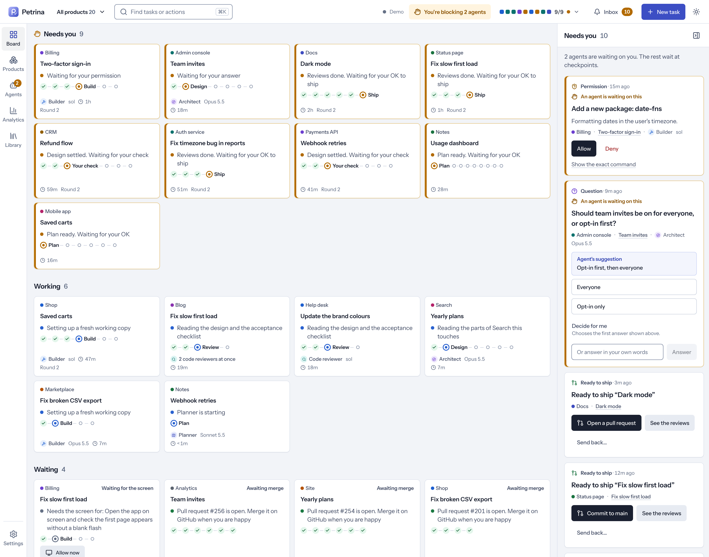
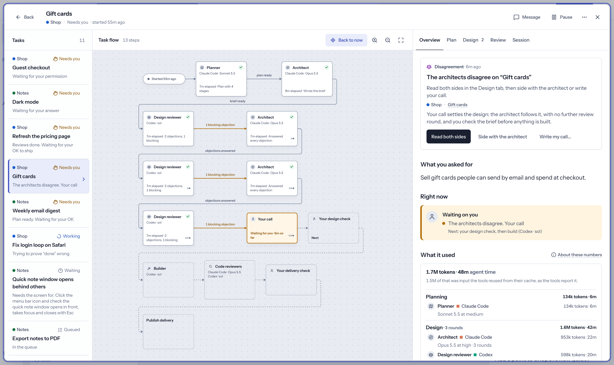
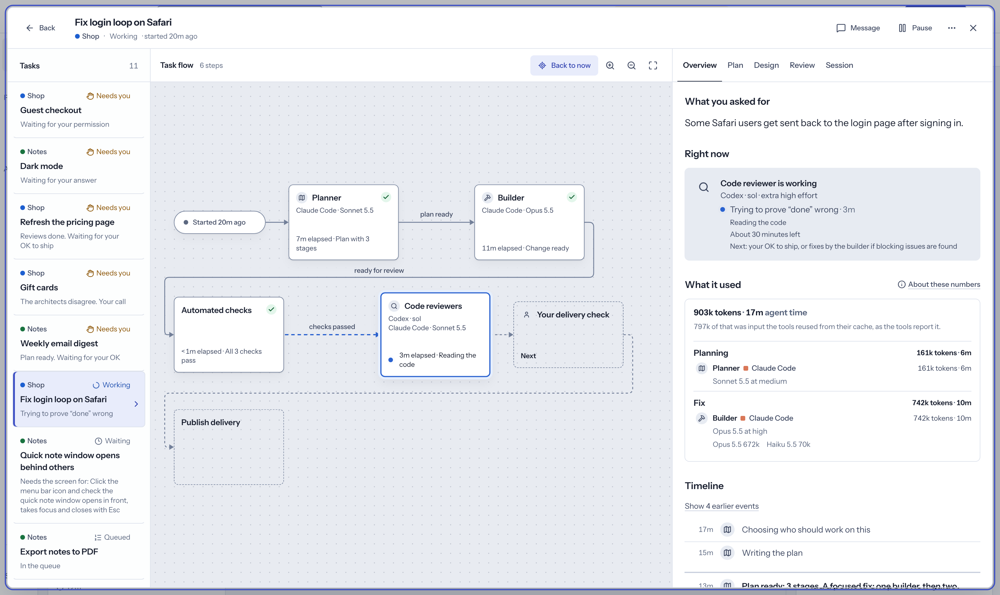

<p align="center">
  
</p>

<h1 align="center">Petrina</h1>

<p align="center">
  Run Claude Code, Codex and Grok from one board through the <a href="https://agentclientprotocol.com">Agent Client Protocol</a>.<br />
  You set priorities. They plan, design, build and review. You get a pull request.
</p>

<p align="center">
  
</p>

## What it does

Write a task in plain language. The agents plan it, design it, build it and review it. The board shows what needs you, what is running and what starts next. Drag cards to change the order. When the work is ready, Petrina opens a pull request, publishes a release or commits to main, according to the task's delivery choice.

All your products share one board and one inbox for questions, permissions and approvals. Petrina runs on your machine with the coding tools you are already signed into. There is no Petrina account, and the app shows plans, progress and results rather than code.

## Design Flow

<p align="center">
  
</p>

An architect proposes the design and a design reviewer challenges it, using different harnesses where available. They work through blocking objections until they agree or reach the round limit. If they still disagree, you make the call. The architect follows that decision, and you check the brief before implementation starts.

## Review Flow

<p align="center">
  
</p>

A review finding must hold up before it can send work back. Reviewers mark findings **Important**, **Nit** or **Pre-existing**. Only confirmed Important findings block delivery; smaller issues and problems the change did not cause stay on the record without another builder round.

| Step | What happens |
| --- | --- |
| **Reviewers** | Reviewers read the change at the same time, each in a separate conversation and working copy. They see neither the builder's transcript nor each other's current verdicts. Important means the change should not ship with the issue; Nit means it is smaller; Pre-existing means this change did not cause it. |
| **Checks** | Petrina runs the product's checks itself. A passing result is evidence from the command, not an agent's claim. |
| **Verifiers** | Support from another tool confirms an Important finding. Otherwise, a fresh verifier on each available tool checks it in parallel, with one vote per tool. At least half must call it real for it to block. Other verdicts record it as a nit, pre-existing or not a bug. |
| **Security** | High-risk work gets a security review, preferring a tool that did not build the change. The same finding rules apply. The planner sets the risk; unrated work counts as medium. |
| **Delivery** | You approve shipping unless the task's settings allow automatic delivery. Petrina publishes the chosen pull request, release or commit. Merging a pull request stays with you. |

## Auto-balancing

New work is balanced across harnesses using their reported usage limits, so one allowance is not exhausted while another still has room.

- Petrina weighs the remaining allowance against the time until reset, using the tightest reported window. Capacity that refreshes soon can be used before it is lost.
- At 80% usage, that tool starts fewer new agents. Your pool size and per-tool caps still apply.
- When the planned model is out of allowance, Petrina looks for another available model on the same tool, then another tool. Balancing changes new starts; it does not interrupt work just because another tool has more room. A step that hits a hard limit can continue with a stand-in. The plan keeps its original assignment, which becomes available again after the reset.
- Reviews preserve their independence. Petrina prefers different tools for the builder, reviewers and security review where available; verification uses fresh conversations and one vote per actual tool.

## Harnesses

A harness is the coding tool that runs a model and manages its conversation, tools and permissions. It is separate from a role: Architect, Builder, Tester and Reviewer can each run on any supported harness.

| Harness | ACP connection | Built-in models |
| --- | --- | --- |
| Claude Code | `claude-agent-acp` adapter | Opus 5.5, Fable 5.1; Sonnet 5.5 as a stand-in |
| Codex | `codex-acp` adapter | sol, astra |
| Grok | Its own ACP server, `grok agent stdio` | Grok 4.7 |

Install and sign into at least one of these tools. Petrina uses your existing installation and login; it needs no separate Petrina account or API-key setup. The Claude Code and Codex adapters are included in the engine's dependencies. Grok connects through its own ACP server.

For each role, Petrina sets the model and effort, provides the task context and working copy, and brings progress, questions and permission requests into the app. You can follow the conversation, queue a message, interrupt it or take over in your terminal. After a restart, Petrina reopens the conversation when the tool supports it; otherwise it starts fresh with the saved task context.

Each harness keeps its own permission checks. Petrina records token usage and agent time and reads the tools' reported allowance windows for balancing. Missing reports stay unknown rather than being guessed.

## Run

Install [Bun](https://bun.sh), plus Rust and the [Tauri prerequisites](https://tauri.app/start/prerequisites/) for the desktop app.

```bash
bun install
bun run tauri dev
```

`bun run open` opens Petrina in a browser connected to the running engine. To try the sample squad without an engine, run `bun run dev` and open [localhost:1430/?demo](http://localhost:1430/?demo).

Early, but working: connected agents already take tasks through to pull requests, releases or commits on main, each in a separate working copy. Run from source for now.

Details are in [docs/design.md](docs/design.md). How the screens are meant to feel is in [docs/ux.md](docs/ux.md).

[MIT](LICENSE)
